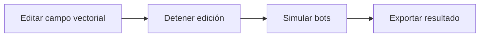

# FlowDrawing: Resumen del proyecto para agentes de IA

Documento de arranque para un agente nuevo. Sintetiza los requerimientos, normas y decisiones de `deveopment_roadmap.txt`, `Software requirements`, `gui_menu_design.txt`, `docs/TestUI.md`, `docs/initial-tasks.md` y `README.md`, contrastados con el código actual.

Si un documento contradice al código o a otro documento, la sección 11 lista la discrepancia y la decisión adoptada. Esas decisiones las tomó el agente por encargo del usuario. Cambiarlas requiere petición explícita.

---

## 1. Qué es la aplicación

Herramienta de dibujo generativo de escritorio. El usuario modifica un campo vectorial con pinceles. Después, bots autónomos recorren el campo y dejan trazados que forman la obra final.

Flujo de trabajo previsto:



Salida prevista: imagen raster (PNG/JPG) o geometría vectorial (SVG/DXF).

---

## 2. Stack técnico y entorno

- Plataforma de ejecución: Windows, aplicación de escritorio local.
- Lenguaje: Java con `sourceCompatibility` y `targetCompatibility` en **Java 11**. No usar sintaxis de Java 14+ (records, switch expressions, text blocks).
- UI: **Swing** (`JFrame`, `JMenuBar`, `JPanel`, `JFileChooser`). Sin dependencias externas (`build.gradle`).
- Build: Gradle con plugins `java` y `application`. `mainClass = 'FlowDrawing'` (paquete por defecto).
- Comandos:
  - Ejecutar: `.\gradlew.bat run`
  - Compilar: `.\gradlew.bat build`
  - Alternativa: importar como proyecto Gradle en IntelliJ, Eclipse o VS Code y ejecutar la clase `FlowDrawing`.
- Carpetas generadas `bin/` y `build/`: no editar a mano.

---

## 3. Estado actual (resumen)

Estado observado en el código. Verificar antes de dar algo por hecho.

| Área | Estado | Archivo(s) principal(es) |
|---|---|---|
| Lienzo, zoom, pan, reset (tecla `r`) | Implementado | `render/CameraController.java` |
| Capas de render (4 `BufferedImage`) | Implementado | `render/LayerRenderer.java` |
| Campo vectorial (rejilla, normalización) | Implementado | `field/VectorField.java`, `field/Vector2D.java` |
| Muestreo del campo | Vecino más cercano. Bilineal pendiente (`TODO` en `VectorField.java`) | `field/VectorField.java` |
| Visualización de flechas | Implementado | `render/FieldRenderer.java` |
| Visualización heatmap / flow map | Parcial. El toggle "heatmap" se mapea a `flowmap` | `FlowDrawing.java`, `render/FieldRenderer.java` |
| Pincel y borrador | Implementado (`BRUSH` / `ERASER`) | `brush/Brush.java`, `brush/BrushEngine.java` |
| Bots, radar de 16 muestras, vida, trazos | Implementado (base) | `bot/Bot.java`, `bot/BotEngine.java` |
| Panel izquierdo de 3 capas (BKGD / VECFD / BOTFD) | Implementado (Fase 1 del refactor) | `ui/ToolPanel.java` |
| Menú (File / Edit / View / Help) | Implementado. Las opciones `[planned]` están deshabilitadas | `ui/AppMenuBar.java` |
| Fondo: imagen y toggle de visibilidad | Implementado | `FlowDrawing.java` |
| Fondo: color y transparencia | Pendiente (`[planned]`) | `FlowDrawing.java` |
| Transparencia de campo y trazos | Pendiente (`[planned]`) | `FlowDrawing.java` |
| Ajustes completos de herramientas BOTFD | Pendiente (ver `docs/TestUI.md`) | `ui/ToolPanel.java` |
| Exportación SVG / DXF / PNG / JPG | Pendiente (menú deshabilitado) | (no existe aún) |
| Guardar / abrir proyecto | Pendiente. Fuera de la v1 según requisitos | (no existe aún) |
| Undo / Redo / Preferencias | Pendiente | `ui/AppMenuBar.java` (deshabilitados) |
| Douglas-Peucker, ordenación por vecino más cercano | Pendiente | (no existe aún) |

Archivos Processing legacy (`src/*.pde`, `src/bots/`, `src/brushes/`, `src/export/`, `src/optimization/`, `src/simulation/`, `src/ui/`) están fuera de `src/main/java`. Gradle no los compila. No editarlos salvo decisión explícita.

---

## 4. Requisitos funcionales

### 4.1 Lienzo (canvas)
- Zoom con la rueda del ratón. Pan arrastrando. Reset de vista con `r`. Ajuste al arrancar (`resetCanvasToFit`).
- Zoom y pan afectan solo a la visualización, nunca a las coordenadas de simulación.
- Orden de render (de abajo a arriba):
  1. Fondo (color o imagen de referencia)
  2. Campo vectorial (opcional)
  3. Trazos del usuario
  4. Trazos y visualización de bots
- Tamaño del lienzo: 2000×2000 por defecto, desde una única constante en `Config.java` (sección 11, #2).

### 4.2 Fondo (BKGD)
- Herramientas: Color, Image, Clear.
- Mostrar u ocultar (implementado).
- Cargar imagen de referencia: PNG, JPG, JPEG, BMP, GIF (implementado con `JFileChooser`).
- Quitar imagen (implementado).
- Selector de color (pendiente) y transparencia de capa (pendiente).
- La imagen de fondo también se pasa a `BotEngine`, porque la luminancia afecta a la vida de los bots.

### 4.3 Campo vectorial (VECFD)
- Rejilla regular. Celda por defecto de 10 px. Cada celda guarda un vector `(vx, vy)`.
- Magnitud máxima por vector: `maxVectorMagnitude` = 5.0.
- Parámetro global `fieldMagnitudeScale` para escalar proporcionalmente todas las magnitudes.
- Regla de normalización (crítica, ver sección 8): si el 30% o más de los vectores alcanza la magnitud máxima, se calcula `scaleFactor = maxMagnitude / currentMax` y se escalan todos los vectores. Función: `normalizeFieldIfNeeded()`.
- Estado: la normalización no escala en el caso habitual; ver sección 11, #3.
- Herramientas: Paint (añade fuerza con el pincel), Erase (resta fuerza con el pincel) y Field Actions (normaliza, aleatoriza o pone a cero todo el campo).
- Visualización: flechas (arrow) o mapa de flujo (heatmap). En el mapa, el tono indica dirección y el brillo indica magnitud.
- Visibilidad independiente de la herramienta activa.

### 4.4 Pincel
- Actualización del campo: `vector += Δmouse * falloff(d)`, donde `Δmouse = posición_actual - posición_anterior`.
- Borrador: `vector -= Δmouse * falloff(d)`. Los vectores tienden a cero.
- Parámetros: tamaño (radio de influencia), dureza (forma de la caída), fuerza (magnitud) y espaciado (muestreo del cursor, similar a Photoshop).
- Tipos de caída (`FalloffType`):
  - Linear: $1 - \frac{d}{r}$
  - Gaussian: $e^{-\frac{d^2}{\sigma^2}}$
  - Hard Edge: $1$ si $d < r$, $0$ en otro caso
- Clase `Brush`: `size`, `hardness`, `spacing`, `falloff`.

### 4.5 Bots
- Atributos: posición, velocidad, vida (`life` / `maxLife`), radar, deriva (`drift`) y trazado (`path`).
- Inicialización (al activar o reiniciar): posición aleatoria en el lienzo, dirección aleatoria, vida máxima.
- Cada iteración:
  1. `fieldForce = muestrear campo(posición)`
  2. `driftVector = randomWalk()`
  3. `dirección = fieldForce + driftVector`
  4. `velocidad = normalizar(dirección) * velocidad_base`
  5. `posición += velocidad`
- Muestreo del campo: bilineal (objetivo). Hoy es vecino más cercano.
- Radar: en lugar de escanear todos los vectores, se usan 16 muestras radiales (`RADAR_SAMPLES`). Cada muestra pondera según la función de dependencia (Linear / Gaussian / Hard Edge), el radio y el peso del centro.
- Repulsión: radio, dureza, fuerza y número de muestras.
- Zozobra (deriva): random walk continuo. Modos: Unique, Collective, Canvas.
- Balance de fuerzas: peso del campo, de la repulsión y de la deriva.
- Vida: cada iteración resta vida. Pierde más sobre píxeles claros del fondo y menos sobre píxeles oscuros (decay por luminancia, activable). Al llegar a 0, el bot reaparece en una posición aleatoria.
- Control de simulación: iniciar, pausar/detener, reiniciar, borrar bots, borrar trazos, número de bots, auto-spawn.
- Trazado: polilínea continua. Un punto nuevo se añade solo si la distancia al último es mayor que un umbral de 1 a 2 px. Así el buffer queda compacto.
- Suavizado adaptativo (objetivo): `v = lerp(v_prev, v_actual, factor)`, según el cambio de ángulo.
- Estabilidad (objetivo): si `fieldVariance`, `botDensity` o `curvatureVariance` indican inestabilidad, reducir deriva y magnitud.
- Representación de bots: punto, círculo o triángulo (indica dirección).
- Color (objetivo): modo constante, opacidad según vida (fade in, estable, fade out gaussiano) o paleta cíclica. Hoy el código oscila entre `#379439` y `#6B4D34` cada 2 s, con fade de trazos activable.

### 4.6 Exportación (pendiente)
- Formatos: SVG y DXF (desde las polilíneas de los bots), y PNG o JPG (raster).
- Antes de exportar, optimizar trazos:
  - Reducción de puntos con Douglas-Peucker (`epsilon` de 1 a 10).
  - Orden de trazos por vecino más cercano para minimizar el recorrido de la pluma.
- Preservar topología: comprobar ángulo y longitud de segmento, y proteger bucles y ramas.

### 4.7 Persistencia
- Versión 1: sin guardado de proyecto (requisitos, sección 13).
- Fase 15 del roadmap: guardado en JSON con tamaño del lienzo, campo, parámetros de bots, semilla e imagen de fondo.
- Menú File con "Save Project" deshabilitado. Decisión: fuera de v1; se implementa en la fase 15 del roadmap (sección 11, #4).

### 4.8 Interfaz de usuario

**Estructura general**
- Barra de título nativa de Windows, con botones estándar. No construir una barra de título personalizada.
- `JMenuBar` bajo la barra nativa:
  - File: New Project, Open Project, Save Project, Save Project As, Export, Exit
  - Edit: Undo, Redo, Preferences (planned)
  - View: Reset View, Zoom In, Zoom Out, Fit Canvas to Screen, Toggle Left Tool Panel
  - Help: About, Documentation, Shortcuts (planned)
  - El menú no contiene controles detallados de herramientas.
- Panel izquierdo de herramientas, ancho 230 px por defecto y 200 px mínimo.
- Área central: lienzo, que es el elemento dominante.

**Panel izquierdo: cuatro niveles**
1. Pestañas de capa (fijas): BKGD, VECFD, BOTFD. Solo una activa, resaltada en verde neón.
2. Controles generales de capa: ojo abierto/cerrado, slider de transparencia sin etiqueta ni porcentaje y acciones contextuales de limpieza/reset.
3. Ribbon de herramientas (fijo): herramientas específicas, de 32 a 44 px. La activa va en verde y las inactivas en gris.
4. Panel de ajustes (con scroll vertical): cambia según la herramienta seleccionada.

**Herramientas por capa**
- BKGD: Color, Image. La fila general limpia la imagen cargada.
- VECFD: Paint, Erase, Field Actions (Normalize Whole Field, Randomize Whole Field). La fila general reinicia el campo a cero.
- BOTFD: Place, Random, Auto, Export. La fila general ofrece botones separados para borrar bots y trazados.

**Ajustes de bots (Place, Random y Auto)**
- General: cantidad y selector de color (popup); la transparencia es general a toda la capa.
- Balance de fuerzas: campo, repulsión, deriva.
- Vida: duración, velocidad, decay por iluminancia.
- Radar de campo: falloff (Linear / Gaussian / Hard Edge), radio, dureza (peso del centro), fuerza.
- Radar de repulsión: falloff, radio, dureza, fuerza o muestras.
- Deriva: modo (Unique / Collective / Canvas), velocidad, fuerza.
- Auto añade Play y Pause.
- Export: selector de formato y botón.

**Estilo**
- Fondo `#2E2E2E`. Texto `#E8E8E8`. Activo `#00FF00`. Hover: borde `#00FF00` sin cambiar el fondo (sección 11, #5).
- Controles interactivos de al menos 44 px de alto (sección 11, #6). Un icono del ribbon puede medir 32 px si su área de pulsación llega a 44 px.
- Sin animaciones. Interacción instantánea. Scroll vertical únicamente.
- La transparencia y visibilidad se guardan por capa y no cambian al seleccionar otra herramienta.

---

## 5. Requisitos no funcionales

- Prioridad: corrección y claridad sobre rendimiento. Es un prototipo.
- Objetivos aspiracionales (Fase 16): 500 bots, lienzo de 4000×4000, rejilla de 10 px, 20 a 40 FPS.
- Render continuo a 60 FPS (`DEFAULT_FPS`).
- Hilos: la UI se construye en el Event Dispatch Thread (`SwingUtilities.invokeLater`). El bucle de render corre en su propio hilo. Modificar componentes Swing desde ese hilo debe hacerse en el EDT.
- Memoria: los trazados se compactan por umbral de distancia. No crecer sin límite.
- Accesibilidad: contraste (`COLOR_CONTRAST_ANALYSIS.md`), navegación por teclado (`KEYBOARD_NAVIGATION_TEST_PLAN.md`), tooltips y etiquetas en todos los controles.

---

## 6. Arquitectura y estructura

```
src/main/java/
├── FlowDrawing.java      JFrame principal, implementa ToolListener, CanvasPanel interno
├── CanvasManager.java    coordinador: update(), normalización, operaciones de lienzo
├── config/Config.java    constantes globales
├── field/                Vector2D, VectorField (rejilla, normalización, FalloffType)
├── brush/                Brush (parámetros y modo), BrushEngine
├── bot/                  Bot, BotEngine
├── render/               CameraController, LayerRenderer, FieldRenderer
└── ui/                   ToolPanel (panel izquierdo), AppMenuBar, CustomButtonUI
    └── Archive/UIPanel.java   obsoleto, no usar
```

**Comunicación entre UI y motor**
- `ToolPanel` no conoce el motor. Emite eventos mediante la interfaz `ToolPanel.ToolListener`.
- `FlowDrawing` implementa `ToolListener` y enruta cada evento a `CanvasPanel`, `BrushEngine` o `BotEngine`.
- Un control nuevo requiere: método en `ToolListener`, implementación en `FlowDrawing` y, si aún no hace nada, `setStatus("[planned] ...")`.

**Flujo de render**

```
FlowDrawing.paintComponent()
  → cameraController.apply()
  → layerRenderer.render(g2d)
      ├─ background
      ├─ fieldRenderer (si visible)
      ├─ strokeLayer
      └─ botLayer
```

---

## 7. Parámetros de configuración (`config/Config.java`)

| Constante | Valor | Uso |
|---|---|---|
| `CANVAS_WIDTH` / `CANVAS_HEIGHT` | 2000 / 2000 | Valor acordado (sección 11, #2). Hoy `Config.java` tiene 800 / 600 y debe actualizarse |
| `CELL_SIZE` | 10.0 | Espaciado de la rejilla en px |
| `DEFAULT_MAX_MAGNITUDE` | 5.0 | Magnitud máxima de vector |
| `NORMALIZATION_THRESHOLD` | 0.3 | Fracción de vectores en máximo que dispara normalización |
| `DEFAULT_BRUSH_SIZE` / `_HARDNESS` / `_SPACING` | 50.0 / 0.5 / 5.0 | Valores iniciales del pincel |
| `DEFAULT_BOT_COUNT` | 50 | Bots iniciales |
| `DEFAULT_BOT_LIFE` | 300.0 | Vida inicial |
| `DEFAULT_BOT_RADAR` | 50.0 | Radio de radar |
| `DEFAULT_BOT_DRIFT` | 0.1 | Deriva inicial |
| `BOT_SPEED` | 2.0 | Velocidad base |
| `RADAR_SAMPLES` | 16 | Muestras radiales del radar |
| `DEFAULT_FPS` | 60 | FPS de render |

Regla: los umbrales y conteos de muestreo viven en `Config.java` para poder ajustarlos sin tocar la lógica.

---

## 8. Reglas críticas (no romper)

1. **Normalización al 30%.** Si el 30% o más de los vectores alcanza la magnitud máxima, escalar todo el campo. Función: `normalizeFieldIfNeeded()`. Estado: no efectiva (sección 11, #3).
2. **Zoom y pan solo visualizan.** Nunca alteran coordenadas de campo ni de simulación.
3. **Visibilidad independiente.** Mostrar u ocultar una capa no cambia la herramienta activa. La transparencia sigue aplicándose mientras la capa es visible.
4. **Arquitectura de subsistemas.** Campo, pincel y bots siguen el diseño del roadmap. No cambiarlos sin aprobación del usuario.
5. **Sin persistencia en v1.** No añadir guardado de proyecto antes de decisión explícita.
6. **Sin dependencias externas** sin aprobación. El `build.gradle` actual no tiene ninguna.
7. **Java 11.** Verificar que el código compila con `sourceCompatibility = 11`.
8. **Constantes en `Config.java`.** No introducir valores mágicos de tuning en la lógica.

---

## 9. Normas de trabajo para el agente

**Antes de editar**
- Leer `deveopment_roadmap.txt`, `Software requirements`, `gui_menu_design.txt`, `docs/TestUI.md` y el archivo a modificar.
- Revisar la sección 11 para no reintroducir una discrepancia ya conocida.

**Durante el trabajo**
- Trabajar por fases. Una fase a la vez. No dejar implementaciones a medias sin marcarlas como `[planned]`.
- Antes de eliminar o reemplazar código, hacer copia de seguridad. Existe precedente: `ToolPanel.java.backup`.
- No eliminar ni mover `Archive/` sin confirmación.
- No renombrar archivos con nombres erróneos (`deveopment_roadmap.txt`, `Software requirements`). El README los referencia.

**Después de cada cambio**
- Compilar con `.\gradlew.bat build`.
- Ejecutar con `.\gradlew.bat run` y comprobar:
  - Sin excepciones en consola.
  - Ventana renderiza y el lienzo responde a zoom, pan y reset.
  - Los toggles de capa muestran y ocultan lo esperado.
  - Ninguna herramienta nueva deja callbacks sin implementar.

**Git**
- `master` contiene versiones estables.
- Ramas de trabajo: `feature/...` o `phase-N-...`. Ejemplos ya citados en la documentación: `phase-1-canvas`, `feature/sidepanel-ux-exploration`.
- Commit por fase, con formato `Phase N: <descripción>`. PR al completar la fase.
- Mantener `.gitignore` para `bin/`, `build/`, `*.class` y `*~`.

**Documentación**
- Idioma: documentación del proyecto en español. Nombres de clases, métodos y variables en inglés (convención observada en el código).
- Mantener `deveopment_roadmap.txt` y `Software requirements` sincronizados con las decisiones tomadas.
- No crear documentación nueva salvo que el usuario la pida.

**Convenciones de código observadas**
- Clases en PascalCase. Constantes en UPPER_SNAKE_CASE.
- Estados visibles al usuario en la barra de estado: `setStatus("...")`.
- Los ajustes de radar se pasan como `FalloffType` (enum dentro de `VectorField`).

**Archivos que no pertenecen a la aplicación**
- Carpetas `.claude/`, `.agents/`, `.cursor/`, `.gemini/`, `.kiro/`, `.trae/`, `.trae-cn/`, `.pi/`, `.codex/`, `.opencode/` contienen skills de diseño (Impeccable). No son requisitos de la app.

---

## 10. Plan de arranque (orden recomendado)

Basado en las "Next session priorities" del roadmap y en `docs/initial-tasks.md`.

1. Verificar que el proyecto compila y se ejecuta: `.\gradlew.bat build` y luego `.\gradlew.bat run`.
2. Aplicar las decisiones de la sección 11. Pedir confirmación solo si una tarea las contradice.
3. Completar la Fase 1 del panel:
   - BKGD: selector de color (popup) y transparencia por capa.
   - VECFD: revisar que Erase coincida con los ajustes de Paint (`docs/TestUI.md`).
   - Sustituir los callbacks `[planned]` de `FlowDrawing.java` por comportamiento real.
4. Completar los ajustes de BOTFD (Place, Random, Auto) según `docs/TestUI.md` y `gui_menu_design.txt`.
5. Verificar que todos los callbacks disparan correctamente (cambio de capa, cambio de herramienta, toggles, transparencias).
6. Motor de campo: muestreo bilineal y vista de mapa de flujo.
7. Pincel: falloff y espaciado completos.
8. Bots: radar completo, suavizado, estabilidad, colores y trazado compacto.
9. Exportación: SVG, DXF, PNG/JPG, con optimización previa (Douglas-Peucker y orden por vecino más cercano).
10. Persistencia y rendimiento, solo si el usuario lo aprueba.

---

## 11. Decisiones adoptadas y discrepancias

Decisiones tomadas por el agente por encargo del usuario. Cambiarlas requiere petición explícita.

| # | Tema | Qué dice cada fuente | Decisión adoptada |
|---|---|---|---|
| 1 | **Plataforma** | Requisitos y roadmap (Fase 0): Java + Processing, "no buscar alternativas". Código y `build.gradle`: Swing puro, sin dependencias. | **Swing se mantiene.** El código activo, el build y la memoria del proyecto usan Swing. Processing queda como legado (`.pde`) y no se migra. Actualizar la Fase 0 del roadmap para reflejarlo. |
| 2 | **Tamaño del lienzo** | `Config.java`: 800×600. `FlowDrawing.java`: 2000×2000 fijo. Roadmap: configurable, 4000 px como objetivo. | **2000×2000 por defecto**, definido en `Config.java` como única fuente. No configurable desde la UI en v1. El objetivo de 4000×4000 queda para la Fase 16. Motivo: es el valor que el código ya usa. Pendiente: que `FlowDrawing.java` lea la constante. |
| 3 | **Regla de normalización** | Regla: `scaleFactor = maxMagnitude / currentMax`. Si los vectores ya están topados en `maxMagnitude`, el factor vale 1 y no hay efecto. `normalization_log.txt` registra `scaleFactor=1,000` en todos los disparos, con `percentAtMax` entre 30% y 40%. | **Mantener la regla del 30% como intención, marcada como no efectiva.** Motivo: el código solo escala si algún vector supera `maxMagnitude`, y con vectores topados el factor vale 1. Definir la corrección en la Fase 3 con una prueba unitaria que reproduzca el caso del log. Hasta entonces, no documentar la normalización como funcionando. |
| 4 | **Persistencia** | Requisitos §13: sin guardado en v1. Roadmap Fase 15: guardado en JSON. Menú: "Save Project" previsto. | **Fuera de v1.** Guardado de proyecto en la Fase 15. Motivo: los requisitos (§13) lo excluyen en v1. `Save Project` sigue deshabilitado. |
| 5 | **Color de hover** | `gui_menu_design.txt`: cian `#00FFD1`. `DISTILL_STRATEGY.md`: usar solo verde. | **Solo verde.** Hover = borde `#00FF00` sin cambio de fondo. Motivo: evita un segundo color de acento. Se descarta el cian. |
| 6 | **Altura mínima de controles** | `gui_menu_design.txt`: 44 px (WCAG). `DISTILL_STRATEGY.md`: 40 px. | **44 px** para controles interactivos. Motivo: es el valor más estricto y cubre ambos documentos. |
| 7 | **Herramientas VECFD** | Roadmap Fase 4: Pencil / Brush / Marker, con falloff implícito. La UI actual separa edición con pincel de las acciones globales del campo. | **Paint / Erase / Field Actions.** Field Actions agrupa normalizar, aleatorizar y reiniciar la rejilla completa. |
| 8 | **Tipos de datos** | Roadmap (pseudocódigo): `PVector`, `PGraphics`. Código: `Vector2D`, `BufferedImage`. | **Java manda:** `Vector2D` y `BufferedImage`. Los nombres de Processing del roadmap son pseudocódigo. |
| 9 | **Archivos legacy** | Hay `.pde` y carpetas en `src/` fuera de `src/main/java`. | **Conservar sin tocar** hasta cerrar la Fase 1. Después, proponer su archivo. No borrar sin aprobación explícita. |
| 10 | **Nombres de archivo** | `deveopment_roadmap.txt` (typo), `Software requirements` (sin extensión). El README los referencia. | **No renombrar.** El README los referencia. Corregir el typo solo si el usuario lo pide. |
| 11 | **Memoria del repositorio** | `/memories/repo/phase-2-architecture.md` sitúa `ui/UIPanel.java` como panel activo. Hoy está en `ui/Archive/` y el panel activo es `ui/ToolPanel.java`. | **Actualizar** `/memories/repo/phase-2-architecture.md` con el estado actual: `ToolPanel` activo, `UIPanel` en `Archive/`. |
| 12 | **Estado de Fase 1** | `docs/PHASE_1_COMPLETION_SUMMARY.md` habla de `ToolPanelRefactored.java`. El código ya está en `ToolPanel.java`. | **Actualizar** `docs/PHASE_1_COMPLETION_SUMMARY.md` al cerrar la fase: `ToolPanelRefactored` pasa a `ToolPanel`. |
