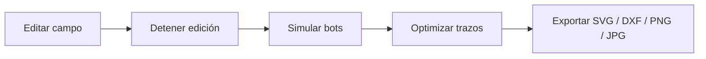
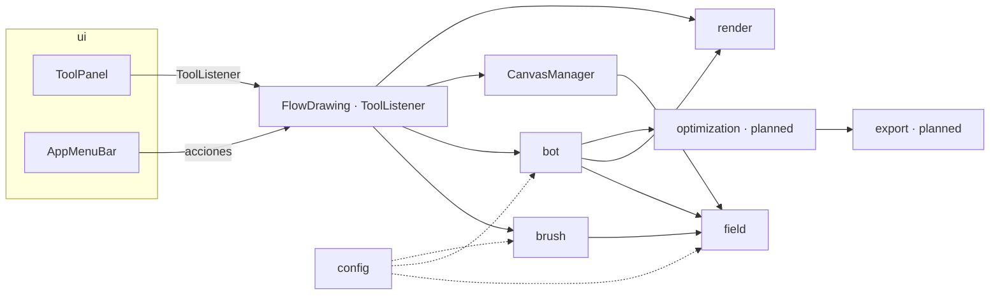

# Arquitectura

Fecha de revisión: 2026-10-13. Describe el código actual y el destino previsto. Las decisiones que lo fundamentan están en [decisions.md](decisions.md).

## 1. Alcance

Aplicación de escritorio para dibujo generativo. El usuario modifica un campo vectorial con pinceles. Después, bots recorren el campo y dejan trazados que forman la obra.



Regla de flujo (SR 12): el campo se edita con la simulación detenida.

## 2. Stack y entorno

| Elemento | Valor | Nota |
|---|---|---|
| Lenguaje | Java, target 11 | Sin sintaxis 14+ (D-008, NFR-02) |
| UI | Swing | D-001 |
| Build | Gradle wrapper, plugins `java` y `application` | Sin dependencias (NFR-04) |
| Sistema | Windows | NFR-01 |
| Comandos | `.\gradlew.bat build`, `.\gradlew.bat run` | Mismo comando en README con `gradle run`, que requiere Gradle instalado |

## 3. Módulos

| Módulo (paquete) | Clases | Responsabilidad | Estado |
|---|---|---|---|
| Entrada y ventana | `FlowDrawing` | JFrame principal. Implementa `ToolListener`. Contiene `CanvasPanel` interno. Punto de composición. | Implementado. Concentra demasiadas responsabilidades (~40 KB). |
| Coordinador | `CanvasManager` | `update()`, normalización, operaciones de lienzo. | Implementado |
| UI | `ui/ToolPanel`, `ui/AppMenuBar`, `ui/CustomButtonUI` | Panel izquierdo, menú. Emiten eventos mediante `ToolListener`. No conocen el motor. | Implementado. `ToolPanel` ~37 KB. |
| UI archivada | `ui/Archive/UIPanel` | Obsoleto. No usar. | Archivado (D-011) |
| Campo | `field/VectorField`, `field/Vector2D` | Rejilla de vectores, muestreo, normalización, `FalloffType`. | Implementado. Muestreo bilineal y normalización global. |
| Pincel | `brush/Brush`, `brush/BrushEngine` | Parámetros del pincel y modos `BRUSH` / `ERASER`. | Implementado |
| Bots | `bot/Bot`, `bot/BotEngine` | Agentes, radar, vida, trazados. | Parcial |
| Render | `render/CameraController`, `render/LayerRenderer`, `render/FieldRenderer` | Cámara (solo visualización), capas de render, visualización del campo. | Implementado |
| Configuración | `config/Config` | Constantes globales. Sin dependencias. | Implementado. Desincronizado (ver §8). |
| Exportación | `export/DrawingExporter` | SVG, DXF, PNG, JPG. | Implementado (E5 básico); optimización pendiente. |
| Optimización | `optimization/PathOptimizer` | Douglas-Peucker, vecino más cercano, protección de esquinas, segmentos y bucles. | Implementado; requiere validación visual (E5). |
| Proyecto | `project/` | Guardado y carga JSON. | Pendiente (E6). |

El paquete `project/` se crea cuando empiece E6. No se crea vacío antes.

## 4. Dependencias permitidas



Reglas:

| Regla | Motivo |
|---|---|
| `ui` no importa `field`, `bot`, `brush` ni `render`. Solo usa `ToolListener`. | ToolPanel no conoce el motor (RS 6). |
| `field`, `brush` y `bot` no importan `ui` ni `javax.swing` salvo en lo estrictamente necesario. | Permite probar la lógica sin ventana. |
| `render` lee estado. No modifica campo ni bots. | Zoom y pan solo visualizan (FR-CAN-04). |
| `export` consume listas de `Vector2D`. SVG y DXF no dependen de Swing. | Facilita pruebas de exportación. |
| `config` no depende de nada. | Constantes accesibles desde todos los módulos. |

## 5. Flujo de datos

### Edición del campo

```
Mouse drag (CanvasPanel)
  → FlowDrawing (traduce a coordenadas de simulación con CameraController)
  → BrushEngine (Δmouse, falloff, spacing)
  → VectorField.addForce() / subtractForce()
  → normalizeFieldIfNeeded()  (ver FR-VEC-04)
  → LayerRenderer (capa de campo)
```

### Simulación

```
Simulation thread
  → BotEngine.update()
      → VectorField.sample(position) y radar
      → Bot.move()  (drift, velocity, life)
      → Bot.path (umbral de distancia)
  → copia de trazados (sincronizada)
Render thread (DEFAULT_FPS)
  → LayerRenderer.render(g2d)
```

### Render

```
FlowDrawing.paintComponent()
  → cameraController.apply()
  → layerRenderer.render(g2d)
      ├─ background
      ├─ fieldRenderer (si visible)
      ├─ strokeLayer
      └─ botLayer
```

## 6. Coordenadas

| Espacio | Qué contiene | Quién lo usa |
|---|---|---|
| Simulación (píxeles del lienzo) | Posición de bots, vectores del campo, trazados, pincel | `field`, `brush`, `bot`, `export` |
| Vista (píxeles de pantalla) | Resultado de zoom y pan | `render`, eventos de ratón en `FlowDrawing` |

La conversión entre ambos espacios vive solo en `CameraController`. Ningún otro módulo aplica zoom o pan.

## 7. Hilos

| Hilo | Responsabilidad | Reglas |
|---|---|---|
| EDT (Swing) | Construcción de UI, eventos de ratón y teclado, menús | Único hilo que toca componentes Swing (NFR-12). |
| Render | Pintado a `DEFAULT_FPS` | Lee capas y trazados. No modifica el estado de simulación. |
| Simulación | `BotEngine.update()` mientras esté en marcha | Pausar = no llamar a `update()`. |

Reglas de concurrencia:
- Editar el campo solo con la simulación detenida (SR 12). Evita carreras entre el pincel y el muestreo de bots.
- Las listas de trazados se copian antes de iterar (NFR-13).
- Cualquier estructura compartida entre hilos se protege con `synchronized` o se copia.

## 8. Configuración

Fuente única: `config/Config.java`. Los valores objetivo vienen de [decisions.md](decisions.md).

| Constante | Valor en código | Valor objetivo | Nota |
|---|---|---|---|
| `CANVAS_WIDTH` / `CANVAS_HEIGHT` | 2000 / 2000 | 2000 / 2000 | D-002. |
| `CELL_SIZE` | 10.0 | 10.0 | Espaciado de rejilla, usado al crear `VectorField` |
| `DEFAULT_MAX_MAGNITUDE` | 5.0 | 5.0 | |
| `NORMALIZATION_THRESHOLD` | 0.3 | 0.3 | Al alcanzar el umbral, el campo se escala proporcionalmente hasta 70 % del límite (D-003) |
| `DEFAULT_BRUSH_SIZE` / `_HARDNESS` / `_SPACING` | 50.0 / 0.5 / 5.0 | Igual | Rango de tamaño 5 a 200 px |
| `DEFAULT_BOT_COUNT` | 50 | 50 | |
| `DEFAULT_BOT_SPAWN_RATE` | 6 bots/s | 6 bots/s | El control permite 1 a 60 bots/s |
| `DEFAULT_BOT_LIFE` | 300.0 | 300.0 | |
| `DEFAULT_BOT_RADAR` | 50.0 | 50.0 | |
| `DEFAULT_BOT_DRIFT` | 0.1 | 0.1 | |
| `BOT_SPEED` | 2.0 | 2.0 | |
| `BOT_SMOOTHING_MIN_FACTOR` / `_MAX_FACTOR` | 0.2 / 0.8 | 0.2 / 0.8 | Interpolación adaptativa según el ángulo de giro |
| `BOT_STABILITY_FIELD_VARIANCE_THRESHOLD` | 1.0 | 1.0 | Umbral de varianza local del campo |
| `BOT_STABILITY_NEARBY_BOT_THRESHOLD` | 8 | 8 | Bots cercanos para máxima inestabilidad por densidad |
| `BOT_STABILITY_CURVATURE_VARIANCE_THRESHOLD` | 0.5 | 0.5 | Umbral de varianza de giro |
| `MIN_RADAR_SAMPLES` / `RADAR_SAMPLES` / `MAX_RADAR_SAMPLES` | 4 / 16 / 32 | Igual | Muestras radiales configurables |
| `DEFAULT_FPS` | 60 | 60 | |
| Pesos de fuerza del bot | 1.0 / 0.25 / 2.0 (según RM). Ubicación por verificar. | En `Config` y ajustables en UI | FR-BOT-06, E3 |

Regla: los umbrales y conteos viven en `Config.java`. No se introducen valores de tuning en la lógica (NFR-14).

## 9. Pipeline objetivo

Mapeo del diagrama final de RM a componentes:

| Paso (RM) | Componente | Estado |
|---|---|---|
| User input | `ui/ToolPanel`, `CanvasPanel` | Implementado |
| Brush engine | `brush/BrushEngine` | Implementado (base) |
| Vector field | `field/VectorField` | Implementado |
| Ultra Kernel | Sin definir en el código. Propuesta: `BotEngine`. | OD-11 |
| Bots simulation | `bot/BotEngine`, `bot/Bot` | Parcial |
| Path streaming | `Bot.path` con umbral | Parcial |
| Rendering engine | `render/*` | Implementado |
| Optimization | `optimization/PathOptimizer` | Implementado; validación visual pendiente |
| Vector export | `export/DrawingExporter` | Implementado (sin optimización) |

## 10. Deuda técnica y riesgos

| ID | Riesgo | Impacto | Propuesta |
|---|---|---|---|
| R-01 | `FlowDrawing.java` (~40 KB) y `ToolPanel.java` (~37 KB) concentran demasiadas responsabilidades. | Cambios difíciles de aislar. | Extraer controladores por capa. Requiere aprobación (RS 11 #4 de subsistemas). Evaluar en E1. |
| R-03 | Normalización no efectiva. | Campo sin límite real de magnitud. | Corregir en E2 con prueba (D-003). |
| R-04 | Sin pruebas automatizadas. | Regresiones silenciosas. | Ver OD-10 y [../testing/test-strategy.md](../testing/test-strategy.md). |
| R-05 | Documentos originales contradictorios: Processing frente a Swing, numeración de fases, hover cian frente a verde. | Decisiones ambiguas. | Resolver con [decisions.md](decisions.md) y sincronizar RM y SR (E0). |
| R-06 | Código legacy de Processing (`.pde`) en `src/`. | Confusión sobre qué compila. | Conservar sin tocar (NFR-16). Proponer destino tras E1. |
| R-07 | Versiones de Gradle y JDK distintas entre sesiones de RM. | Build no reproducible. | Fijar en `gradle-wrapper.properties` (NFR-06). |
| R-08 | Hilos de simulación y render comparten listas de trazados. | Excepciones de concurrencia. | Copiar antes de iterar (NFR-13). Probar con 100+ bots en E3. |
